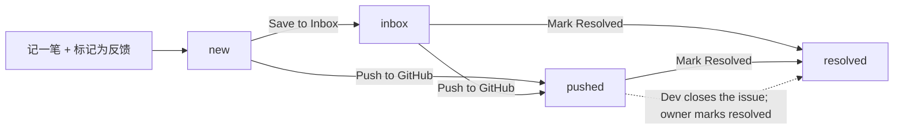

# Feedback Lifecycle

**Status**: Approved
**Refs**: Issue #14, ES-012, ES-017, ES-018, ES-023
**Related**: `core/system-manifest.md`, `docs/pm/inbox/README.md`

## 1. The State Machine

Feedback notes live in `signals` (`name = 'note'`) and use
`feedback_status`. The four states are:

| State | Meaning |
|---|---|
| `new` | Marked as feedback; not sent anywhere. |
| `inbox` | Committed to `docs/pm/inbox/`; Dev sees it on the next pull. |
| `pushed` | GitHub issue created; Dev is notified immediately. |
| `resolved` | Owner marked it handled. |

`resolved` is not written automatically when the GitHub issue is closed. The
owner (or Dev via the API) marks it resolved in the Feedback tab. A webhook
that closes the loop automatically is not implemented.

## 2. Actions and Effects

| Action | Where | Database effect | Dev sees | Status change |
|---|---|---|---|---|
| **记一笔** + **标记为反馈** | Home / note | `value.feedback = true`; status starts at `new` if unset | No | → `new` |
| **Save to Inbox** | Note / Feedback | Commits `docs/pm/inbox/YYYY-MM-DD-<noteId>.md`; sets `feedback_status = 'inbox'` | Yes, on next pull | `new` → `inbox` |
| **Push to GitHub** | Note / Feedback / chat message | Creates an issue; stores `github_issue_url` / number; sets `pushed` | Yes, immediately | `new` or `inbox` → `pushed` |
| **Mark Resolved** | Feedback tab | Sets `feedback_status = 'resolved'` | No automatic notification | `inbox` or `pushed` → `resolved` |
| **Copy as Text** | Note / Feedback | None | No | No change |
| **Copy** | Chat message menu | None | No | No change |
| **dismiss** | Feedback tab | Clears `value.feedback` | No | Not a state-machine transition |

### Copy actions are local only

`Copy as Text` (formerly "Copy for AI") and the chat `Copy` action only write
to the clipboard. They do not write to Supabase, do not change
`feedback_status`, and do not notify Dev. They are deliberately outside the
state machine.

`Copy for Dev` no longer exists. Sending to Dev means **Push to GitHub** (or
**Save to Inbox**); both are stateful.

## 3. Failure Behavior

- **Save to Inbox fails**: the status stays `new`; the API returns an error.
- **Push to GitHub fails**: the status stays at its previous value. If GitHub
  is not configured, the UI copies the issue text to the clipboard as a
  fallback, but that is still a local copy, not a `pushed` state.
- **Mark Resolved**: the API only accepts `resolved` from `inbox` or `pushed`.
- **Resolved is terminal**: the UI disables Push to GitHub for resolved notes;
  the API returns `409 note already resolved` if it is called directly.
- **Duplicate sends**: Push to GitHub returns the existing issue instead of
  creating a duplicate.

## 4. Inbox Consumption

See `docs/pm/inbox/README.md` for the full process. In short:

1. Owner taps **Save to Inbox**.
2. The API commits `docs/pm/inbox/YYYY-MM-DD-<noteId>.md` via the GitHub
   Contents API.
3. Dev reads new files on the next pull; the team's target review time is
   10:00 daily.
4. After handling, Dev moves the file to `docs/pm/inbox/archive/` (preferred)
   or prefixes the filename with `[已处理]`.

Historical inbox files are not deleted as part of routine cleanup.
